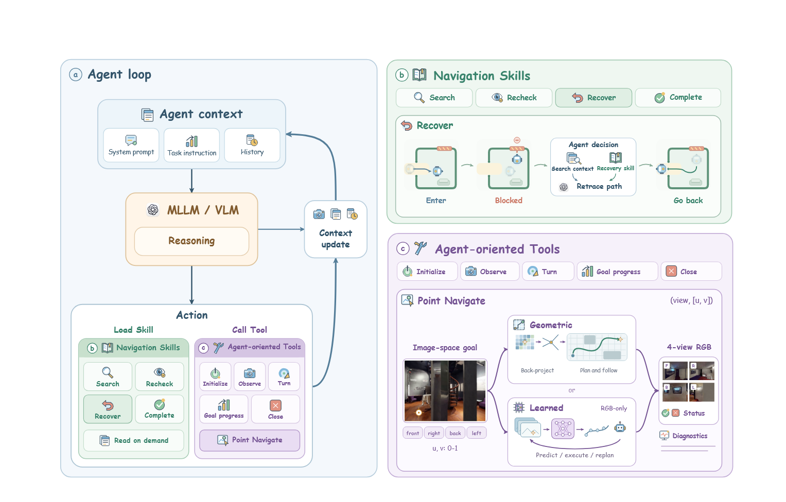

# SuperNav：第 3 节概述中英对照

范围：用户提供的第 3 节 Overview、图 2 图注及图内标签。摘录译稿；未提供页码，仅使用章节与块编号定位。

索引：[正文](#S001) · [图 2](#F001) · [图内标签](#T001) · [术语表](#terminology)

**Source:** 第 3 节 Overview / S001

**Original:** 3 NAVIGATION AGENT HARNESS

**中文:** 3 导航智能体运行框架

**Source:** 第 3 节 Overview / S002

**Original:** Overview. SuperNav combines a pretrained MLLM with a navigation-specific harness to form an embodied navigation Agent that sustains decisions and actions across different requests. A request may specify a target, an ordered sequence of targets, or a high-level need; the Agent must interpret that request and act until it can judge whether the completion conditions are met. The MLLM performs this interpretation and decision-making, while the harness organizes execution and context through an agent loop.

**中文:** 概述。SuperNav 将预训练的多模态大语言模型（MLLM）与专为导航设计的运行框架相结合，构建一个具身导航智能体，使其能够针对不同请求持续作出决策并执行动作。请求可以指定一个目标、一个有序的目标序列，或某种高层需求；智能体必须理解该请求，并持续行动，直至能够判断任务的完成条件是否满足。MLLM 负责请求理解与决策，而运行框架通过智能体循环组织执行过程和上下文。

**Source:** 第 3 节 Overview / S003

**Original:** Within this loop, agent-oriented Tools are callable operations for observation, motion, and task-state management, and Navigation Skills are instructions the MLLM can read for search, verification, and recovery. As illustrated in Figure 2, the MLLM interprets observations, selects a Tool call, and uses the returned feedback to decide again, consulting Skills when relevant.

**中文:** 在这一循环中，面向智能体的工具是可调用的操作，用于观察、运动和任务状态管理；导航技能则是 MLLM 可以读取的指导说明，用于搜索、核验与恢复。如图 2 所示，MLLM 理解观察结果，选择要调用的工具，并利用工具返回的反馈再次作出决策，在需要时查阅相关技能说明。

**Figure:** 图 2 / F001，放置于首次实质引用段落 S003 之后。

**Source:** 图 2 图注 / C001

**Original:** Figure 2: Navigation with Skills and agent-oriented Tools. (a) The Agent loop maintains context for MLLM reasoning, Skill loading, and Tool calls. (b) Navigation Skills guide search, candidate rechecking, recovery, and completion; the recovery example shows the Agent retracing its path after a blocked passage. (c) Agent-oriented Tools support observation, motion, goal-progress tracking, and task closure. Point navigation shares an image-space goal interface across geometric and learned execution backends.

**中文:** 图 2：借助技能与面向智能体的工具进行导航。（a）智能体循环维护上下文，以支持 MLLM 推理、技能加载和工具调用。（b）导航技能指导搜索、候选目标复核、恢复与任务完成；其中，恢复示例展示了智能体在通道受阻后沿来路返回的过程。（c）面向智能体的工具支持观察、运动、目标进度跟踪和任务结束。点目标导航在几何式与学习式执行后端之间采用统一的图像空间目标接口。

**Source:** 第 3 节 Overview / S004

**Original:** We first describe how the loop coordinates these capabilities (Section 3.1), then develop the Tool interfaces (Section 3.2) and Skill guidance (Section 3.3).

**中文:** 我们首先介绍这一循环如何协调上述能力（第 3.1 节），随后说明工具接口（第 3.2 节）与技能指导（第 3.3 节）。

**Source:** 用户粘贴的图内标签及此前提供的图 2 图像 / T001

| 图内英文 | 中文 |
|---|---|
| Agent loop | 智能体循环 |
| Agent context | 智能体上下文 |
| System prompt | 系统提示 |
| Task instruction | 任务指令 |
| History | 历史记录 |
| MLLM / VLM | 多模态大语言模型 / 视觉语言模型 |
| Reasoning | 推理 |
| Context update | 上下文更新 |
| Action | 行动 |
| Load Skill | 加载技能 |
| Call Tool | 调用工具 |
| Read on demand | 按需读取 |
| Navigation Skills | 导航技能 |
| Search | 搜索 |
| Recheck | 复核 |
| Recover | 恢复 |
| Complete | 完成 |
| Agent decision | 智能体决策 |
| Search context | 检索上下文 |
| Recovery skill | 恢复技能 |
| Retrace path | 沿来路返回 |
| Enter | 进入 |
| Blocked | 受阻 |
| Go back | 返回 |
| Agent-oriented Tools | 面向智能体的工具 |
| Initialize | 初始化 |
| Observe | 观察 |
| Turn | 转向 |
| Goal progress | 目标进度 |
| Close | 关闭会话 |
| Point Navigate | 点目标导航 |
| (view, [u, v]) | （视角，[u, v]） |
| Image-space goal | 图像空间目标 |
| front / right / back / left | 前 / 右 / 后 / 左 |
| u, v: 0-1 | u、v 的范围为 0-1 |
| Geometric | 几何式 |
| Back-project | 反投影 |
| Plan and follow | 路径规划与跟随 |
| or | 或 |
| Learned | 学习式 |
| RGB-only | 仅使用 RGB |
| Predict / execute / replan | 预测 / 执行 / 重新规划 |
| 4-view RGB | 四方向 RGB 图像 |
| F / R / B / L | 前 / 右 / 后 / 左 |
| Status | 状态 |
| Diagnostics | 诊断信息 |

**术语表**

| 规范术语 | 定义或说明 | 原文形式 | 统一译法 |
|---|---|---|---|
| MLLM | multimodal large language model | MLLM | 多模态大语言模型 |
| VLM | vision-language model | VLM | 视觉语言模型 |
| navigation agent harness | harness 指组织决策、执行与上下文的运行框架 | navigation agent harness | 导航智能体运行框架 |
| Agent | embodied navigation Agent 译为具身导航智能体 | Agent | 智能体 |
| Navigation Skills | 模型可读取的指导说明 | Navigation Skills | 导航技能 |
| agent-oriented Tools | 可调用的环境操作 | agent-oriented Tools | 面向智能体的工具 |
| context | Agent context / Context update 中保持同一译法 | context | 上下文 |
| Point Navigate / Point navigation | 图内标签与图注采用相同译法 | Point Navigate / Point navigation | 点目标导航 |

**阅读提示：**此处的 Skills 是可读取的指导说明，Tools 是可调用的操作；正文分别定义了二者。
