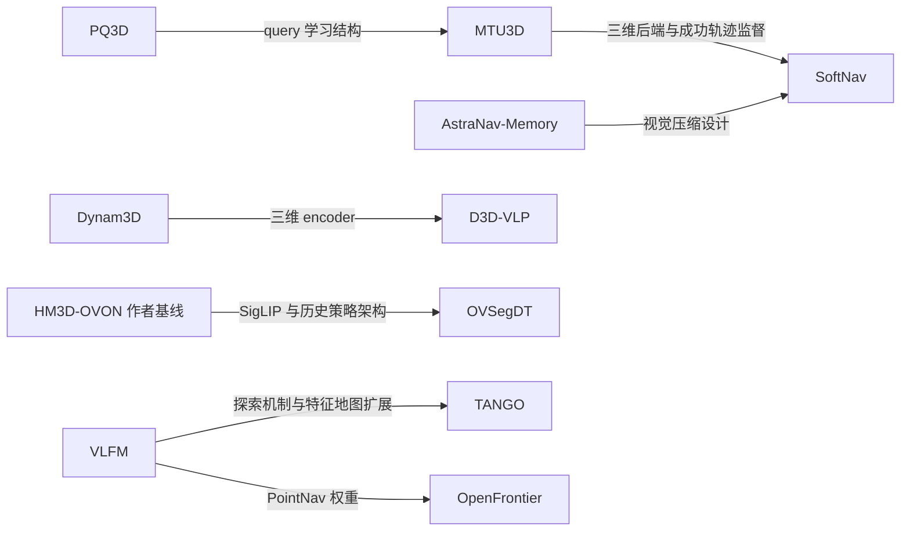

# 论文、底层编码器与训练关系总表

核对日期：2026-10-14。范围为当前目录的 **18 篇独立论文**，另列 **PQ3D、Dynam3D 两篇基础依赖**。目录有 21 份 PDF：VLFM、MSGNav 各有重复副本，HM3D-OVON 有另一版本。既有主索引列了 17 篇，本表补入目录中实际存在的 MOPA；未修改原索引或论文文件。

本表依据本地论文的方法、训练配置和附录；必要时补读作者公开原文。页码均为 **PDF 从 1 开始的物理页码**，不是会议连续页码。Uni-NaVid 原库存 PDF 没有可提取正文，改读已有的作者 v2 副本。模型名称出现于 Related Work 或 References，不据此认定其为实际使用的组件。

## 阅读约定

- **编码器**：将 RGB、深度、点云、文本等转换为特征，如 SigLIP、CLIP、DINO、VGGT、ResNet。
- **检测/分割器**：如 YOLO-World、SAM、FastSAM、YOLOE；它们包含视觉网络，但与独立特征编码器分列。
- **决策模型**：如 Qwen、Vicuna、空间 Transformer、GRU；模型中的视觉编码器与语言/动作网络分别记录。
- **投影/压缩模块**：如 MLP projector、PatchMerger；负责连接表征，通常不能与完整感知编码器等同。
- **冻结**表示该论文的相应训练阶段不更新参数；**直接调用**表示用已有模型推理；**未明确**表示原文不足以确认逐模块更新范围。
- “不训练导航搜索策略”不意味着全部组件没有训练历史。例如 VLFM 自己训练 PointNav，MOPA 在 MultiON 设置中微调检测器。

## 一、14 篇导航方法论文

| 论文 | 视觉/三维/目标编码器及感知组件 | 决策模型与连接模块 | 训练、冻结与复用关系 |
|---|---|---|---|
| OVSegDT | 冻结的 **SigLIP 图像＋文本编码器**；**ResNet9** 编码目标二值 mask；部署时 **YOLOE** 生成 mask | 4 层 decoder Transformer、动作/价值头、mask 重建头 | 沿用 HM3D-OVON 的 SigLIP＋历史 Transformer 架构，新增 mask 分支。训练导航策略与新增分支，以 BC/PPO 混合训练，再用 YOLOE 预测 mask 做策略适配；没有证据表明该阶段微调 YOLOE |
| VLFM | **BLIP-2** 图文相似度；**YOLOv7** 检测 COCO 类、**GroundingDINO** 检测其他类；**Mobile-SAM** 提取目标轮廓；低层使用深度 PointNav | 语义价值地图＋frontier 选择；低层 PointNav 策略 | BLIP-2、检测器、分割器直接调用。语义搜索不做目标任务训练；作者用 **VER 在 HM3D 上训练 PointNav**。正文没有细分 BLIP-2 与 PointNav 的全部 backbone 型号 |
| OpenFrontier | 预训练 **FrontierNet** 提议视觉 frontiers；**SAM3** 目标分割；VLM 处理带标记图像 | 主实验 **Gemini-2.5-flash**；可替换其他 VLM；调用 PointNav | 不对 VLM 做导航微调；FrontierNet 使用已有权重；低层调用 **VLFM 提供的 PointNav 权重**。OpenFrontier 称其为 DD-PPO point-goal policy，原 VLFM 的具体训练配置使用 VER。FrontierNet 是整个已有模型，不是本文新训练的独立图像编码器 |
| TANGO | **BLIP-2** 用于探索价值与问答；**CLIP** 分类；**OWLv2/DETR** 检测；**SuperGlue** 实例图像匹配；深度 PointNav | **GPT-4o** 生成调用工具的程序；解释器执行 | 不做目标任务微调。复用 VLFM 风格探索并扩展为可重查询的特征记忆；已有 PointNav 在 HM3D 训练集预训练，随后作为工具调用。GPT-4o 是规划器，不是三维编码器 |
| MOPA | MultiON：离线微调 **Faster R-CNN**；ObjectNav：冻结的 **Detic**；PointNav 的深度视觉编码器为 **ResNet50** | PointNav：MLP＋LSTM＋actor/critic；语义地图和规则探索 | 复用 DD-PPO PointNav。MultiON 的自然物体/圆柱检测器有专门训练；ObjectNav 的 Detic 保持冻结。因此需要区分检测器训练与导航策略复用 |
| MTU3D | **FastSAM** 区域分割；**DINO** 图像特征；**稀疏卷积 U-Net** 点云特征；目标使用 **CLIP 文本/图像编码器**；PQ3D-inspired query decoder | 在线物体/frontier queries＋动态空间记忆；**Spatial Reasoning Transformer** 统一选择物体或探索点 | PQ3D 提供 query 学习思想与解码结构，MTU3D 增加在线导航设计。Stage 1 训练 query proposal，之后冻结；Stages 2–3 训练空间推理与任务策略。正文未逐个明确 DINO、CLIP、U-Net 在所有阶段的参数更新范围 |
| MSGNav | **YOLO-World** 检测；**SAM** 分割；**CLIP/OpenCLIP** 编码物体外观。附录列出的视觉特征模型为 ViT-H-14-quickgelu/DFN5B | 多模态三维场景图＋提示；主实验 **GPT-4o**，附加实验 **Qwen-VL-Max** | 感知模块和 VLM 直接调用，无导航任务专用训练。图和图像证据输入 VLM；不使用 PQ3D，不训练三维 soft-token projector。闭源 VLM 内部编码器未公开 |
| D3D-VLP | 直接采用 **Dynam3D encoder**，生成全景 patch、instance、zone 三层 tokens；其底层来自 CLIP 图像特征与三维聚合 | **NVILA-Lite-2B**；空间 MLP、3D projector、grounding/navigation heads、学习式 waypoint predictor | 训练统一规划–grounding–导航模型，使用 SLFS 与在线 DAgger 增强；训练 waypoint predictor。**Dynam3D encoder 在 D3D-VLP 训练时是否更新，原文未明确**，不能照搬 Dynam3D 原论文的冻结规则 |
| SoftNav | 冻结的 **MTU3D/PQ3D 系在线三维后端**提供 768 维物体/frontier queries；冻结 **DINOv3** 提供图像特征；沿用 AstraNav-Memory 的视觉压缩设计 | **Qwen2.5-VL-3B**；768→1408→2048 MLP projector；视觉记忆＋3D soft tokens | 冻结感知与 VLM 基础权重，训练 **MLP projector＋LoRA**。MTU3D 成功轨迹提供 1,187 个监督决策样本。跨基准共享的是导航 projector/LoRA，PQ3D 后端采用 MTU3D 的基准专用 stage-2 权重 |
| CompassNav | **Qwen2.5-VL-7B-Instruct 自带视觉编码器**；深度/occupancy 用于候选动作生成，未额外采用 PQ3D、VGGT 等编码器 | Qwen 模型预测候选索引；另有未经微调的 Qwen Stop Agent；数据教师为 **Qwen-QvQ** | SFT 采用 **LoRA**，随后 GRPO。**Fig. 4 把视觉和语言两路都标为可训练**；附录给出 LoRA 层类型，但没有清晰拆分视觉 tower 的逐层更新范围。本表不将其标为“视觉编码器冻结” |
| Uni-NaVid | **EVA-CLIP** 编码视频帧；在线多级池化与合并；没有独立三维场景编码器 | 两层 MLP projector＋**Vicuna-7B**；导航/问答统一输出 | Stage 1 只训练 projector；Stage 2 训练 projector＋LLM。按原文明确列出的训练对象，视觉编码器不在更新对象中；此判断依据两阶段配置，不依赖“通常冻结视觉 tower”的推断 |
| AstraNav-Memory | 冻结 **DINOv3**；PixelUnshuffle＋Conv/BN/SiLU 压缩；压缩结果接入 **Qwen2.5-VL 原生 ViT 的首个 block** | **Qwen2.5-VL-3B** 导航模型；图像与位姿历史 | 明确冻结 DINOv3；训练压缩模块并微调 Qwen 导航模型。后续 Qwen ViT 各层是否全部更新，论文未细分。正文称 DINOv3-ViT-Base，附录又称 ViT-M 为默认，本表保留模型家族而不强行统一型号 |
| JanusVLN | **Qwen2.5-VL 原生视觉编码器**负责语义；**VGGT 的预训练 encoder＋fusion decoder**负责空间几何 | **Qwen2.5-VL-7B**；投影/特征融合；双路 KV 记忆 | 明确冻结语义和空间编码器；只微调 **LLM＋projection layer**。DINOv2、SigLIP 2 在本文中是替换 VGGT 的消融项，不是主模型组件 |
| OmniNav | **Qwen2.5-VL-3B-Instruct 自带视觉编码器**；坐标 MLP；没有声明另外接入 DINO、PQ3D 或 VGGT | Qwen 快慢系统；**DiT/flow-matching policy** 预测连续 waypoints | Stage 1 做 AR 多任务训练，Stage 2 添加并训练 flow policy，同时联合部分 AR 数据。**视觉编码器是否冻结、逐层更新范围未明确** |

### 逐篇来源定位

1. **OVSegDT**：[本地 PDF](E:/科研_机器人/HM3D-OVON/HM3D_OVON_Papers/01_模仿学习与强化学习导航/2026_CVPR_OVSegDT.pdf)，§4.1/Fig. 2，PDF p.4–5；YOLOE 适配见 §4.3/§5，PDF p.6–8。
2. **VLFM**：[本地 PDF](E:/科研_机器人/HM3D-OVON/HM3D_OVON_Papers/02_语义地图与前沿探索/VLFM_Vision-Language_Frontier_Maps_for_Zero-Shot_Semantic_Navigation.pdf)，§IV/Figs. 2–4，PDF p.3–5，尤其 p.4 的 PointNav 训练配置。
3. **OpenFrontier**：[本地 PDF](E:/科研_机器人/HM3D-OVON/HM3D_OVON_Papers/02_语义地图与前沿探索/2026_RSS_OpenFrontier.pdf)，§III–IV，PDF p.3–6，尤其 p.5 的模型/权重配置与 p.6 的 SAM3。
4. **TANGO**：[本地 PDF](E:/科研_机器人/HM3D-OVON/HM3D_OVON_Papers/03_大模型规划与工具调用/2025_CVPR_TANGO.pdf)，§3–4/Figs. 2–3，PDF p.3–6。
5. **MOPA**：[本地 PDF](E:/科研_机器人/HM3D-OVON/HM3D_OVON_Papers/03_大模型规划与工具调用/2024_WACV_MOPA.pdf)，§4/§5.3/Fig. 2，PDF p.3–5；冻结 Detic 见 PDF p.8。
6. **MTU3D**：[本地 PDF](E:/科研_机器人/HM3D-OVON/HM3D_OVON_Papers/04_三维空间表征与目标推理/2025_ICCV_MTU3D_Move_to_Understand_a_3D_Scene.pdf)，§3.1–3.4/Fig. 3，PDF p.4–5；query proposal 后续冻结见 §4 Implementation Details，PDF p.6。
7. **MSGNav**：[本地 PDF](E:/科研_机器人/HM3D-OVON/HM3D_OVON_Papers/04_三维空间表征与目标推理/2026_CVPR_MSGNav.pdf)，§3.2/Fig. 3，PDF p.4，§4.1，PDF p.6；具体感知型号见 [作者附录 §6.3/Table 7](https://arxiv.org/html/2511.10376v3#S6.SS3)。
8. **D3D-VLP**：[本地 PDF](E:/科研_机器人/HM3D-OVON/HM3D_OVON_Papers/04_三维空间表征与目标推理/2026_CVPR_D3D-VLP.pdf)，§3.1–3.3/Figs. 2–3，PDF p.3–5；§4.1 Implementation Details，PDF p.6。
9. **SoftNav**：[本地 PDF](E:/科研_机器人/HM3D-OVON/HM3D_OVON_Papers/04_三维空间表征与目标推理/2607.14586v1.pdf)，§III/Fig. 2，PDF p.2–4；具体 LoRA 与基准专用后端权重见 §IV-A，PDF p.4。
10. **CompassNav**：[本地 PDF](E:/科研_机器人/HM3D-OVON/HM3D_OVON_Papers/05_视觉语言动作决策与视频记忆/2026_ICLR_CompassNav.pdf)，Fig. 4，PDF p.6；Implementation Details，PDF p.8；Stop Agent，PDF p.15；LoRA/GRPO 配置，PDF p.21。
11. **Uni-NaVid**：[已有作者副本](E:/科研_机器人/HM3D-OVON/paper_analysis/all_papers_8h/Uni-NaVid_author_copy.pdf)，§IV–V，PDF p.4–7；亦可读 [作者 v2](https://arxiv.org/html/2412.06224v2)。
12. **AstraNav-Memory**：[本地 PDF](E:/科研_机器人/HM3D-OVON/HM3D_OVON_Papers/05_视觉语言动作决策与视频记忆/2026_CVPR_AstraNav-Memory.pdf)，§3/Fig. 2，PDF p.4–5；§4.1，PDF p.5；DINO 型号补充实验，PDF p.11。
13. **JanusVLN**：[本地 PDF](E:/科研_机器人/HM3D-OVON/HM3D_OVON_Papers/05_视觉语言动作决策与视频记忆/ICLR-2026-janusvln-decoupling-semantics-and-spatiality-with-dual-implicit-memory-for-vision-language-navigation-Paper-Conference.pdf)，§3.3，PDF p.6；§4.1 Implementation Details，PDF p.7；额外编码器消融，PDF p.9。
14. **OmniNav**：[本地 PDF](E:/科研_机器人/HM3D-OVON/HM3D_OVON_Papers/05_视觉语言动作决策与视频记忆/2026_ICLR_OmniNav.pdf)，§3，PDF p.3–5；§4.3，PDF p.7–8。

## 二、4 篇数据集/基准论文中的编码器

这四篇的主要贡献是数据和任务。表中的编码器属于数据生成、作者基线或对照实验，不能理解成“数据集本身有一个编码器”。

| 论文/作者系统 | 编码器与感知模型 | 后续模型/训练关系 |
|---|---|---|
| HM3D Semantics：RL 基线 | **ResNet50** 编码 RGB-D | 接两层 LSTM＋策略/价值头，使用 DD-PPO 训练 ObjectNav |
| HM3D Semantics：IL 基线 | RGB：随机初始化 **ResNet18**；深度：PointNav/DD-PPO 预训练 **ResNet50**；语义：已有 **RedNet** | 接 GRU，以人类轨迹行为克隆训练；本文没有逐一给出上述 backbone 的冻结范围 |
| HM3D Semantics：modular 基线 | **SemExp** 的语义地图与 CNN 特征；语义预测、几何投影属于已有模块 | 学习式 exploration policy＋几何局部规划；用 PPO 训练探索策略 |
| HM3D-OVON：BC/DAgger/RL/BCRL/DAgRL | **冻结 SigLIP 图像＋文本编码器** | 相同的历史 Transformer 策略，不同 imitation/RL 训练配方；DAgRL+OD 加 **OWLv2** 与目标接近模块 |
| HM3D-OVON：VLFM 对照 | 原 VLFM 感知架构，检测器改为 **OWLv2** | 这是基准论文中的修改版，不能将 OWLv2 写成原 VLFM 的唯一检测器 |
| GOAT-Bench：Modular GOAT | **Detic** 语义检测；**CLIP** 物体/文本特征；实例图像通过关键点匹配 | 显式语义/实例记忆＋模块化导航。数据生成另外调用 **BLIP-2＋ChatGPT-3.5**，二者不等同于在线导航编码器 |
| GOAT-Bench：SenseAct-NN Skill Chain | ObjectNav：冻结 **CLIP ResNet50＋CLIP text**；LanguageNav：冻结 **CLIP ResNet50＋BERT-base-uncased**；ImageNav：冻结 **CroCo-v2** | 分别训练每种技能的 GRU 策略；底层编码器冻结见附录 C.1 |
| GOAT-Bench：SenseAct-NN Monolithic | 冻结 **CLIP ResNet50** 观察编码器与 **CLIP 图像/文本**目标编码器 | 单一 GRU 策略跨子任务携带隐藏状态，用 RL 训练 |
| SG3D：SG-LLM | **Spatial Transformer** 将物体编码为 tokens；**Vicuna-7B** 接收物体 tokens 与任务描述 | 训练 sequential adapter、grounding head 等，并用 **LoRA rank 16** 适配 LLM；正文未明确 SG-LLM 最底层对象 backbone 与逐模块冻结范围 |
| SG3D：3D-VG/纯 LLM 基线 | 3D-VG 对照统一用 **PointNet++**；纯 LLM 对照用预训练 **PointNet++ classifier** 预测类别，再组织 JSON | PointNet++ 属于明确说明的基线设置，不能仅凭这点认定 SG-LLM 自身也使用完全相同的 backbone |
| SG3D：导航基线 | 模块化 Embodied VideoAgent：**CLIP** 物体/指令特征；端到端：**CLIP**＋GRU | 后者从 GOAT-Bench 的 SenseAct-NN Monolithic 初始化，再在 SG3D-Nav 微调 |

来源：

- [HM3D Semantics PDF](E:/科研_机器人/HM3D-OVON/HM3D_OVON_Papers/00_数据集与任务基准/2023_CVPR_HM3D_Semantics_ObjectNav.pdf)：§4.1–4.3，PDF p.7–8。
- [HM3D-OVON PDF](E:/科研_机器人/HM3D-OVON/HM3D_OVON_Papers/00_数据集与任务基准/2024_IROS_HM3D_OVON.pdf)：§III Policy Architecture，PDF p.3–4；§IV，PDF p.5–6。
- [GOAT-Bench PDF](E:/科研_机器人/HM3D-OVON/HM3D_OVON_Papers/00_数据集与任务基准/2024_CVPR_GOAT_Bench.pdf)：§4–5，PDF p.4–6；附录 C.1，PDF p.12–14。
- [SG3D PDF](E:/科研_机器人/HM3D-OVON/HM3D_OVON_Papers/00_数据集与任务基准/2024_SG3D_Sequential_Grounding_and_Navigation.pdf)：§4–5/Fig. 5，PDF p.5–6；PointNet++ 对照设置，附录 A.3，PDF p.15；LoRA 配置，附录 A.4，PDF p.16。

## 三、两篇基础依赖

| 基础论文 | 真正底层的编码器 | 训练和后续使用 |
|---|---|---|
| PQ3D | 点云：**PointNet++**；体素：**稀疏卷积 U-Net/Mask3D 风格**；多视角：**OpenSeg/OpenScene 风格特征**；文字/图像提示：**CLIP**；随后使用 prompt-guided query decoder | 将不同输入对齐到 segment-level 三维坐标空间并做多任务 query 学习。MTU3D 借鉴其结构并改造为在线导航，SoftNav 使用的是后者的后端，不能把原始 PQ3D 的全部 encoder 清单直接照抄为 SoftNav 的实际组件 |
| Dynam3D | **CLIP ViT-L/14@336** 图像 patch 特征＋**FastSAM** masks；Transformer instance/zone encoders；generalizable feature field | 先训练三维 representation model；训练导航 3D-VLM 时保留已预训练的 representation/feature field，优化 **LLaVA-Phi-3-mini**。D3D-VLP 采用其三维 encoder，但其决策模型改为 **NVILA-Lite-2B** |

来源：[PQ3D 原文 §3.1–3.3](https://arxiv.org/html/2405.11442v2#S3)，[Dynam3D NeurIPS 2025 正式 PDF](https://proceedings.neurips.cc/paper_files/paper/2025/file/e1a1847e39a7b79b41199176b152f0e6-Paper-Conference.pdf)，§3/PDF p.3–7 与训练附录 PDF p.23。

## 四、论文之间明确的依赖关系

箭头标签区分架构来源、模型后端/权重和训练数据。共享模型家族不自动意味着复用另一篇导航论文的权重。

模型家族共享关系：

| 模型家族 | 使用者 | 使用位置 |
|---|---|---|
| SigLIP | HM3D-OVON 作者策略、OVSegDT | 冻结图像/目标文字编码 |
| DINO/DINOv3 | MTU3D：DINO；AstraNav-Memory、SoftNav：DINOv3 | RGB 表征；不同论文版本不能混同 |
| CLIP/OpenCLIP | MSGNav、MTU3D、GOAT-Bench、SG3D 导航/对照、TANGO、PQ3D、Dynam3D/D3D-VLP 系 | 分别是物体外观、目标编码、图文分类或空间场的底层视觉特征 |
| EVA-CLIP | Uni-NaVid | 视频帧视觉编码 |
| VGGT | JanusVLN | RGB 导出的空间几何特征 |
| BLIP-2 | VLFM、TANGO、GOAT-Bench 数据生成 | 分别用于语义相似度、工具问答和目标属性生成 |
| Qwen2.5-VL-3B | SoftNav、AstraNav-Memory、OmniNav | 接入方式和训练对象不同；不代表三篇互相复用导航权重 |
| Qwen2.5-VL-7B | CompassNav、JanusVLN | 前者做动作候选决策，后者融合 VGGT 双路特征 |
| Vicuna-7B | Uni-NaVid、SG-LLM | 一个接视频 tokens，一个接三维物体 tokens |
| ResNet | MOPA、OVSegDT、HM3D Semantics、GOAT-Bench | 深度 PointNav、mask、RGB-D 或 CLIP-RN50；不能只按“ResNet”认定相同训练权重 |

## 五、待进一步代码核对的范围

1. **D3D-VLP**：是否更新 Dynam3D encoder。
2. **OmniNav**：视觉编码器/连接层/语言主干的具体冻结配置。
3. **CompassNav**：视觉分支 LoRA 的实际覆盖范围；Fig. 4 与文字训练配置需对照官方代码。
4. **SG-LLM**：对象特征最底层 backbone，以及对象编码器在 SG3D 微调时是否冻结。
5. **MTU3D**：DINO 的具体版本、CLIP/U-Net 在感知 Stage 1 中的参数更新范围。
6. **AstraNav-Memory**：主文与附录 DINOv3 型号命名，以及压缩后 Qwen ViT 的逐层更新配置。

以上条目是当前原文证据的明确边界；表中没有将它们补成默认冻结或默认全量训练。
